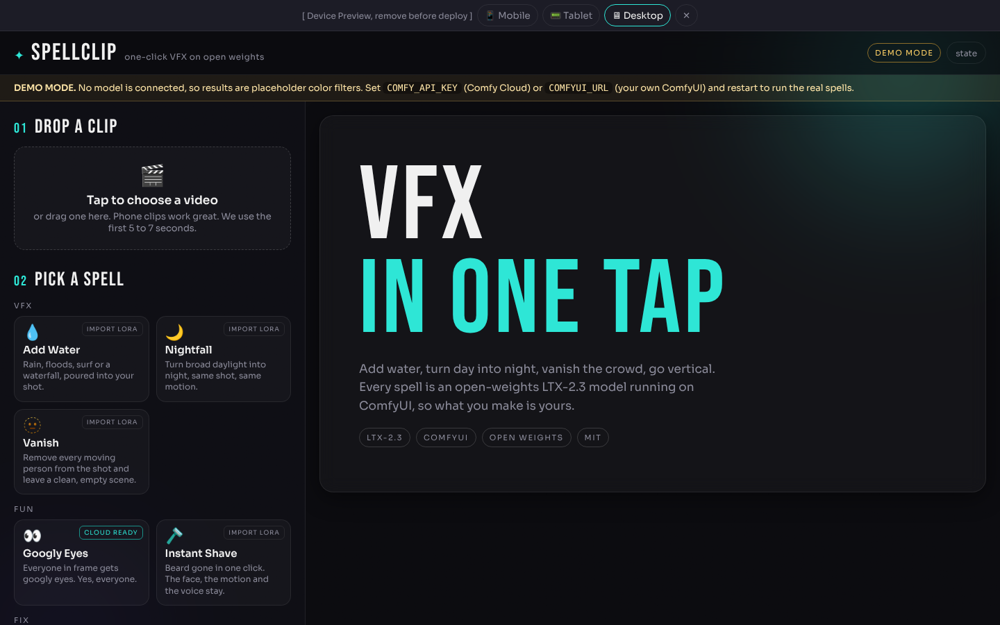

# Spellclip

**Drop a clip. Pick a spell. Get a share-ready VFX video.**

Spellclip is a one-tap VFX app built on ComfyUI. Every "spell" is an open-weights
LTX-2.3 video-to-video model (an IC-LoRA or LoRA on top of the 22B base) that keeps
your subject, framing and motion and changes one thing: it pours water into the shot,
turns day into night, makes the crowd vanish, colorizes old film, erases an object, or
paints the missing top and bottom so a landscape clip becomes a true 9:16 vertical.
Spells stack, so "Nightfall" then "Add Water" gives you a storm at night.

Built for Comfy's Open Source Higgsfield competition (LTX VFX track, open weights only).



## What you get

| Spell | What it does | Model (open weights) |
|---|---|---|
| Add Water | Rain, flood, surf, waterfall or a stream, with five flavors | Lightricks LTX-2.3 IC-LoRA Water Simulation |
| Nightfall | Daylight to night, same shot and motion, three looks | Lightricks LTX-2.3 IC-LoRA Day-To-Night |
| Vanish | Removes every moving person, rebuilds the background | Lightricks LTX-2.3 IC-LoRA Clean Plate |
| Googly Eyes | Everyone gets googly eyes | TheBurgstall LTX-2.3 Googly Eyes LoRA |
| Instant Shave | Beard off, face and voice intact | Lightricks LTX-2.3 IC-LoRA Instant Shave |
| Colorize | Black and white to natural color | Lightricks LTX-2.3 IC-LoRA Colorization |
| Restore | Scratched, faded footage comes back sharp | Dearchive LoRA (Comfy template library) |
| Erase Object | Name the foreground object, it disappears | Obscura Remova LoRA (Comfy template library) |
| Clean Text | Strips subtitles, captions and watermarks | Subtitle removal LoRA (Comfy template library) |
| Go Vertical | Landscape to 9:16, the model outpaints the bars | LTX-2.3 IC-LoRA Outpaint (oumoumad) |

Every result comes with a before/after split video for sharing, a hold-to-compare
preview, a download button, and a "stack another spell" button that feeds the result
back in as the next input.

## How it works

```
your clip  ->  ffmpeg pre-size (24 fps, 8n+1 frames, 32-multiple canvas)
           ->  ComfyUI graph (core nodes only): LTX-2.3 checkpoint + spell LoRA
               + LTXVAddGuide (reference video) + distilled 8-step sampler
           ->  H.264 MP4 + before/after split + poster
```

One graph, ten spells. `app/graph.py` builds the API-format workflow from
`app/spells.json`; `workflows/` holds the exported JSON for each spell. The graph
uses only nodes that ship with ComfyUI, so it runs on Comfy Cloud and on a stock
local install with no custom node packs.

Where it runs is up to you:

- **Comfy Cloud** through the official `comfy-sdk` (set `COMFY_API_KEY`).
- **Your own ComfyUI** on a GPU through its REST API (set `COMFYUI_URL`).
- **Demo mode** with no model at all, so you can click through the app first.

## Quick start (about 5 minutes)

You need Python 3.10+ and git. ffmpeg is bundled through the `imageio-ffmpeg`
package, so you do not have to install it separately.

```bash
git clone https://github.com/landoCommandoz/repo-for-the-contest spellclip
cd spellclip
python -m venv .venv
source .venv/bin/activate        # Windows: .venv\Scripts\activate
pip install -r app/requirements.txt
python app/server.py             # opens on http://localhost:8787
```

With no key set, the app starts in **demo mode** and says so in a yellow banner.
Everything works end to end, but the "result" is a placeholder color filter.

### Run the real spells on Comfy Cloud

1. Get an API key from Comfy Cloud (a paid Cloud plan is required for API access).
2. In the same terminal:

```bash
export COMFY_API_KEY="comfyui-..."   # PowerShell: $env:COMFY_API_KEY = "comfyui-..."
python app/server.py
```

3. The header pill now says **Comfy Cloud**. Spells marked **cloud ready** use LoRA
   files that Comfy's own template library already hosts. For the others, open the
   Cloud Model Library, press Import, and paste the Hugging Face link from the table in
   `workflows/README.md` (Creator plan or above; the Lightricks repos are gated, so
   accept their license on Hugging Face first).

### Run on your own GPU

1. Install ComfyUI (a recent build; LTX-2.3 is supported natively) and start it.
2. Download the model files listed in `workflows/README.md` into the matching
   `models/` folders. The fp8 checkpoint needs roughly 24 GB of VRAM; use the
   `--reserve-vram` flag or a low-VRAM loader if you are tight.
3. Point Spellclip at it:

```bash
export COMFYUI_URL="http://127.0.0.1:8188"
python app/server.py
```

The Comfy SDK also works against a `comfy-api-proxy` next to your ComfyUI; set
`COMFY_BASE_URL` instead and leave `COMFYUI_URL` unset.

### Settings

| Variable | Meaning |
|---|---|
| `COMFY_API_KEY` | Comfy Cloud key. Never commit it. |
| `COMFY_BASE_URL` | A Comfy API deployment or a self-hosted proxy, instead of Cloud. |
| `COMFYUI_URL` | A plain local ComfyUI (REST). |
| `SPELLCLIP_BACKEND` | Force `cloud`, `local` or `demo`. |
| `SPELLCLIP_DATA` | Where uploads and results are stored (default `app/data`). |
| `SPELLCLIP_MAX_UPLOAD_MB` | Upload limit, default 300. |
| `PORT` | Server port, default 8787. |

## Using the app

1. **Drop a clip.** Phone videos are fine. The first 5 s (or 7 s) are used.
2. **Pick a spell.** Some spells ask for one line about what is in the shot. That
   line goes into the prompt so the model keeps everything else the same.
3. **Tune it.** Frame (auto, 9:16, 16:9, 1:1), quality (Fast 960x544, HD 1280x704,
   Full 1920x1088), length, and whether to keep your audio or let the model make sound.
4. **Cast.** A progress bar shows upload, queue, generation and finishing.
5. **Share.** Hold the result to see the original, switch to Split, download either.
6. **Stack.** Run another spell on the result.

The **state** button in the header opens a small panel with the live app state.
The device preview bar at the top resizes the app to phone, tablet or desktop.
Both are labeled and can be removed before a public deploy.

## Project layout

```
app/
  server.py        FastAPI: upload, jobs, progress, files, static UI
  backend.py       Comfy Cloud (comfy-sdk), local ComfyUI (REST), demo
  graph.py         builds the API-format ComfyUI graph for a spell
  media.py         ffmpeg: probe, pre-size, mux, before/after split, poster
  spells.json      the spell registry: LoRA file, strength, prompt template, flavors
  static/          index.html, styles.css, app.js (no build step)
workflows/         one exported API-format workflow per spell, plus index.json
scripts/           export_workflows.py, validate_with_comfyui.py
examples/          gallery of outputs
docs/              contest notes, screenshots, status
DEMO.md            demo video script
SUBMISSION.md      submission form answers
```

## Blueprint

### Structure map

- **Upload step** takes a video file and shows it in the stage.
- **Spell grid** lists spells by group (VFX, Fun, Fix, Frame) from the registry.
- **Tune step** shows flavor chips, the scene line, frame, quality, length, sound, and an advanced strength and seed.
- **Cast button** posts the form to the server and switches the stage to progress.
- **Server job runner** pre-sizes the clip, builds the graph, runs it on the chosen backend, encodes the result and the split.
- **Result stage** plays the result, compares against the input, downloads, stacks, re-rolls with a new seed.
- **Recent list** restores past jobs from disk, including after a refresh.

### State map

| State | In | Out |
|---|---|---|
| empty | app load, Start over | file chosen, recent job opened |
| preview | file chosen | Cast (progress), change clip (empty) |
| progress | Cast, re-roll, stack, opening a running job | job done (result), job error (error) |
| result | job done | Stack (progress), re-roll (progress), Start over (empty) |
| error | job error, server unreachable, upload rejected | Try again (progress), Start over (empty) |

Server job states: queued, running (stages preparing, uploading, queued, generating, finishing), done, error.
A server restart marks any in-flight job as error with a plain message.

### Risk flags and how they are handled

1. **Model files not on the backend.** Comfy Cloud only has the template-library LoRAs
   by default. The registry marks each spell `cloud_ready`, the UI badges it, and the
   backend maps a missing model into a plain-English error that points to the README.
2. **Clip shape.** LTX needs 8n+1 frames and 32-multiple sizes. The server never trusts
   the upload: ffmpeg re-encodes to 24 fps, fits the canvas, and rounds the frame count.
3. **Long waits and lost connections.** Jobs run in a worker thread and persist to disk.
   The browser polls, tolerates network blips, and restores the last job after a reload.

## Validation without a GPU

`scripts/validate_with_comfyui.py` submits every exported workflow to a running
ComfyUI. With empty placeholder model files you get a structural check (every node,
input name, type and combo value accepted) even on a CPU-only machine.

## License and credits

Spellclip is MIT licensed. LTX-2.3 and the Lightricks IC-LoRAs are released under the
LTX-2 Community License; the Googly Eyes LoRA by TheBurgstall, the outpaint LoRA by
oumoumad, and the Dearchive, Obscura Remova and subtitle-removal LoRAs come from
Comfy's template library, each under its own license. Gemma 3 is the text encoder.
Built with ComfyUI and the Comfy SDK.
